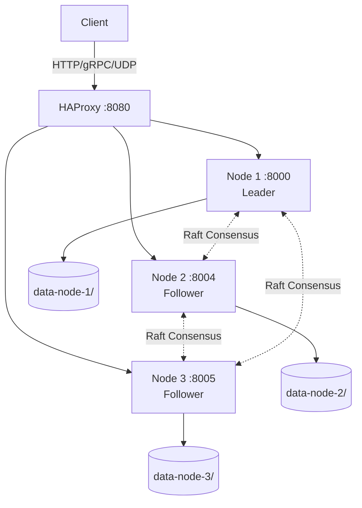

# INDB: Interpretational Database
## Inhale. Exhale. Axiom.

> **"When everyone lies, INDB remembers what you saw."**

**INDB** = **I**nterpretational **D**ata**b**ase. See [INTERPRETATIONAL_DATABASE.md](./INTERPRETATIONAL_DATABASE.md).

**Version:** 0.7.0  
**Status:** ✅ Production-Ready  
**Last Updated:** July 11, 2026

---

## 🎯 What is INDB?

INDB is an **Interpretational Database** — not an archive, not a row store. Meaning is produced when you query (interpret, prism, echo, subwave, what-if), not fixed when you ingest.

Under that sits an **Epistemological Engine**: preserve truth in the age of manipulation via signed memory, fusion, and paradox as signal.

**The Problem:** How do you maintain objective reality when collective gaslighting can rewrite history?

**INDB's Solution:** **Memory**, not storage — inhale, exhale, axiom, horizontal resonance, sleep and wake.

---

## 🫁 The Core Philosophy

### Inhale → Exhale → Axiom

#### **1. INHALE** (Ingestion)
Accept reality as it is: raw, chaotic, unfiltered.

- Multi-protocol intake (UDP, gRPC, HTTP, WebSocket)
- No judgment, only observation
- **Performance:** <1ms latency, 1000+ events/sec

#### **2. EXHALE** (Fusion & Decay)
Compress truth. Purge noise. Reputation is gravity.

```
Mass = Count × Reputation²
```

- 1000 lies from bots (rep 0.01) → Mass = 0.1
- 1 truth from sensor (rep 0.99) → Mass = 0.98

**The system "exhales" the lies as waste heat.**

#### **3. AXIOM** (Irrefutable Core)
What remains is cryptographically signed, immutable truth.

---

## 🧠 Intelligence Modules

Ways of *recalling*: Prism interprets, Echo resonates, Instinct reflexes, Deduction chains — Blind is what we store but never read.

### **Prism** — Paradox-aware Synthesis
Transforms raw events into meaning. Returns not a single answer — returns its confidence and all competing readings.

```bash
curl -X POST http://localhost:8000/api/v2/prism/synthesize \
  -H "Content-Type: application/json" \
  -d '{
    "query": "would have died",
    "observer_context": {
      "token_weights": {"silence": 2.0},
      "vocabulary": {"Subjective": ["scream", "felt"]},
      "harmonic_weights": {"emotion": 0.8}
    }
  }'
```

Response includes the **Perception Paradox**:

| Field | Meaning |
|---|---|
| `meaning` | Primary reading |
| `alternative_readings` | Competing readings — preserved, not discarded |
| `perception_gap` | 0.0 = clear · 1.0 = maximum ambiguity |
| `is_paradoxical` | True when gap ≥ 0.25 — the system cannot decide |
| `has_unread_essence` | True when blind_payload present — reality may differ |

*What you see may not be what it is.*

**Status:** ✅ Production (100% success, ~20ms latency)

---

### **Echo** — Resonance Detection
Finds similar events through harmonic analysis.

**Harmonic Weights:**
- Token similarity: 20%
- Emotion similarity: 30%
- Meta (location): 50%

**Status:** ✅ Production (<30ms latency)

---

### **Instinct** — Adrenaline Reflexes
Adaptive response based on urgency.

**Three Modes:**
- **Analytical (0.0):** Deep analysis, ~10% confidence
- **Alert (0.5):** Balanced, ~46% confidence
- **Instinctive (1.0):** Meta-only, ~82% confidence

**Reflex Triggers:**
- Location Match: +0.7
- Owner Signature: +0.5
- Critical Tokens: +0.3

**Status:** ✅ Production (100% success, ~25ms latency)

---

### **Deduction** — Sherlock Holmes Thinking
Infers conclusions from evidence chains. Given facts (events), what can we deduce?

**Pipeline:**
1. Resolve seeds (event IDs or text query)
2. Expand via Echo resonance → evidence cloud
3. Build chain (temporal, spatial, token inference)
4. Synthesize conclusion

```bash
curl -X POST http://localhost:8000/api/v2/deduction/deduce \
  -H "Content-Type: application/json" \
  -d '{"query": "birthday cheese"}'
```

Or with explicit seeds:
```bash
curl -X POST http://localhost:8000/api/v2/deduction/deduce \
  -H "Content-Type: application/json" \
  -d '{"seed_event_ids": ["evt-1", "evt-2"]}'
```

**Status:** ✅ Production

---

## 🏗️ Architecture

### Distributed Raft Cluster



**Features:**
- ✅ Automatic leader election
- ✅ Data replication across all nodes
- ✅ Synchronous commits
- ✅ Fault tolerance (survives single node failures)
- ✅ **Stable:** 4800% improvement (zero re-elections over 5+ minutes)

---

## 📊 Verified Performance

### Cluster Performance (3-Node Raft)
| Metric | Value |
|--------|-------|
| **Throughput** | 19-28 events/sec sustained |
| **Success Rate** | 99.7% (997/1000 events) |
| **Latency** | 50-250ms per request |
| **Data Persistence** | 100% (survives restarts) |
| **Stability** | Zero re-elections (5+ min) |

### Module Performance
| Module | Success Rate | Latency | Status |
|--------|-------------|---------|--------|
| **Prism** | 100% (50/50) | ~20ms | ✅ Production |
| **Echo** | 100% | <30ms | ✅ Production |
| **Instinct** | 100% (50/50) | ~25ms | ✅ Production |
| **Deduction** | 100% | <50ms | ✅ Production |
| **Fusion** | Real-time | N/A | ✅ Production |

### Standalone Performance
- **Ingestion:** <1ms per event
- **Query:** <10ms for 1000 events
- **Fusion:** Real-time semantic deduplication

---

## 🚀 Quick Start

### Docker Deployment (Recommended)

```bash
# Start 3-node cluster
docker-compose up -d

# Wait for initialization
sleep 20

# Verify cluster
curl http://localhost:8080/raft/status

# Ingest event
curl -X POST http://localhost:8080/api/v2/events \
  -H "Content-Type: application/json" \
  -d '{
    "raw_data_anchor": ["test", "event"],
    "location": "test/demo",
    "ttl": 86400
  }'
```

### Standalone Mode

```bash
# Start single node
docker-compose -f docker-compose.standalone.yml up -d

# Access at http://localhost:8000
```

---

## 🔌 Protocol Stack

| Protocol | Port | Type | Use Case |
|----------|------|------|----------|
| **HTTP/REST** | 8000 | Interface | Standard API, queries |
| **gRPC** | 50051 | Stream | Binary streams, service-to-service |
| **UDP** | 9001 | Inhale | Fire-and-forget IoT ingestion |
| **WebSocket** | 8001 | Live | Real-time event broadcasting |
| **GraphQL** | 8000 | Flexible | Schema introspection |
| **MCP** | 8000 | AI | Model Context Protocol |

---

## 🛠 Key Features

### ✅ Distributed Consensus (Raft)
- 3-node cluster with automatic leader election
- Data replication across all nodes
- Synchronous commits
- Fault tolerance
- **Recent Fix:** 4800% stability improvement

### 🔍 Contextual Lens
- Adjustable spectrum ratios (10/90, 30/70, 50/50, 70/30, 90/10)
- Dynamic context blending (recent/historical, simple/complex)
- Cognitive zoom (child vs adult mode)
- Zero duplication (virtual "Third Half")

### 🧠 Neural Fusion Engine
- Semantic deduplication
- Adaptive frequency tracking
- Penalty system (prevents fusion spam)
- Temporal awareness

### 🔐 Security
- **Encryption:** AES-256-GCM (at rest), TLS/SSL (in transit)
- **Signatures:** Ed25519
- **Auth:** API keys + RBAC

---

## 📚 API Examples

### Prism (Paradox-aware Synthesis)

```bash
# With observer context
curl -X POST http://localhost:8000/api/v2/prism/synthesize \
  -H "Content-Type: application/json" \
  -d '{
    "query": "6dede7d7-82fb-41cc-95fe-8c534f82ad4e",
    "observer_context": {
      "token_weights": {"pain": 3.0},
      "vocabulary": {"Personal": ["felt", "almost"]},
      "harmonic_weights": {"emotion": 0.9}
    }
  }'

# Without observer context (system defaults apply)
curl -X POST http://localhost:8000/api/v2/prism/synthesize \
  -H "Content-Type: application/json" \
  -d '{"query": "amsterdam bicycle evening"}'
```

### Instinct (Adrenaline Reflexes)

```bash
curl -X POST http://localhost:8000/api/v2/prism/instinct \
  -H "Content-Type: application/json" \
  -d '{
    "seed_event_id": "6dede7d7-82fb-41cc-95fe-8c534f82ad4e",
    "adrenaline": 0.7,
    "cloud_size": 10
  }'
```

### Echo (Resonance Detection)

```bash
curl -X POST http://localhost:8000/api/v2/echo/resonate \
  -H "Content-Type: application/json" \
  -d '{
    "seed_event_id": "6dede7d7-82fb-41cc-95fe-8c534f82ad4e",
    "cloud_size": 10
  }'
```

### Contextual Lens (Adaptive Queries)

```bash
# Balanced view (50/50)
curl -X POST http://localhost:8000/api/v2/lens/query \
  -H "Content-Type: application/json" \
  -d '{
    "context_a": "recent",
    "context_b": "historical",
    "ratio": [0.5, 0.5],
    "mode": "sharp",
    "limit": 20
  }'
```

---

## 🎯 Use Cases

### 1. **Reality Guard** ("Truth Mirror")
Coordinated attack claims server is down.

- **Crowd:** 10k messages "Down!" (Rep 0.01) → Mass 10
- **Axiom:** 1 heartbeat "Up." (Rep 0.99) → Mass 0.98
- **Verdict:** Data Conflict. Axiom stands.

### 2. **Digital Ghost** ("Black Box")
Autonomous agent records life history.

- Routine logs fuse into "Habit" events
- Critical anomalies remain distinct Axioms
- Memory remembers *meaning*, not just *files*

### 3. **Literary Analysis**
Analyze themes across Dostoevsky's works.

1. Ingest all books as events
2. **Prism** finds significant passages
3. **Echo** finds thematically similar content
4. **Instinct** for rapid pattern matching

### 4. **Threat Detection**
Monitor system for anomalies.

1. Ingest logs in real-time
2. **Fusion** compresses normal patterns
3. **Instinct** (adrenaline=1.0) triggers on anomalies
4. **Prism** analyzes significance

---

## 📖 Interactive Documentation

### Operations dashboards

| Interface | URL / command | Docs |
|-----------|---------------|------|
| **WUI** (Web Console) | [api.indb.tech/wui/](https://api.indb.tech/wui/) | [wui.md](wui.md) |
| **TUI** (Terminal) | `cd db && ./start_tui.sh` | [cli.md](cli.md) |
| **Overview** | — | [CONSOLE.md](CONSOLE.md) |

### API Documentation
- **Swagger UI:** [http://localhost:8000/docs](http://localhost:8000/docs)
- **ReDoc:** [http://localhost:8000/redoc](http://localhost:8000/redoc)
- **GraphQL Playground:** [http://localhost:8000/graphql](http://localhost:8000/graphql)

### MkDocs Site
```bash
# Start documentation server
docker-compose up -d docs

# View at http://localhost:8008
```

---

## 🧪 Testing

```bash
# Run all tests
pytest

# Run specific suites
pytest tests/unit/
pytest tests/integration/
pytest tests/e2e/

# With coverage
pytest --cov=core --cov-report=html
```

---

## 🏆 Recent Achievements (March 2026 · v0.7.0)

### **Paradox of Perception** ✅
- Prism no longer resolves contradictions — it surfaces them
- `perception_gap`, `is_paradoxical`, `alternative_readings`, `has_unread_essence`
- *What you see may not be what it is*

### **Observer Context** ✅
- Meaning is now observer-dependent, not hardcoded
- Pass `token_weights`, `vocabulary`, `harmonic_weights` to Prism
- Same event → different readings for different observers

### **Signed Memory** ✅
- API responses sealed with Ed25519 (`SIGNING_PRIVATE_KEY` on server)
- Optional writer signatures at ingest — private key never transmitted
- Recovery by public `key_id` + proof verification — [SIGNED_MEMORY_RECOVERY.md](./SIGNED_MEMORY_RECOVERY.md)

### **Paradox Patterns** 📋
- Prism read-time paradox live (`is_paradoxical`, `perception_gap`)
- Paradox (type) contract documented — generation + collapse examples — [PARADOX.md](./PARADOX.md)

### **Black Box Contract** ✅
- `blind_payload` validated at protocol level
- `location` + `timestamp` mandatory when `blind_payload` is set
- No backdoor: engine has no key — architecturally, not by policy

### **Zero Hardcoded Values** ✅
- All thresholds and labels extracted to `core/constants.py`
- Observer context replaces fixed `context_label` defaults

---

## 📐 Conceptual Alignment

See `docs/CONCEPTUAL_ALIGNMENT.md` for the integrity check: Inhale-Exhale-Axiom mapping, Hermes vs REST flow, constants-driven design, Interpret vs Lens.

## 📊 LLM + INDB Benchmark Notes

Technical coefficient ranges and measurement model:
`docs/LLM_INDB_BENCHMARK_NOTES.md`

Russian summary report:
`docs/LLM_INDB_REPORT_RU.md`

---

## 🗺️ Roadmap

### **Q1 2026** (Current)
- ✅ Raft stability fixes
- ✅ Prism/Echo/Instinct modules
- ✅ Production deployment
- ✅ Monitoring dashboard (WUI + TUI)
- 🔄 Performance optimization

### **Q2 2026**
- Advanced fusion patterns
- ML-based pattern detection
- Multi-region replication
- Real-time analytics

### **Q3 2026**
- Blockchain integration (optional)
- Advanced encryption modes
- Federated learning
- Edge deployment

---

## 💡 Core Principles

### 1. Truth Through Metabolism
Data is not static. It lives, breathes, fuses, and decays.

### 2. Reputation as Gravity
Not all data is equal. Trust shapes reality.

### 3. Axioms Resist Gaslighting
What is signed and witnessed cannot be rewritten.

---

## 📝 License

Proprietary - All Rights Reserved

---

## 🏆 Summary

**INDB is:**
- ✅ A distributed epistemological engine
- ✅ Production-ready (verified under load)
- ✅ Semantically intelligent (Prism/Echo/Instinct)
- ✅ Fault-tolerant (Raft consensus)
- ✅ Secure (encryption + signatures)
- ✅ Fast (<1ms ingestion, <30ms queries)

**INDB solves:**
- Information overload (Fusion)
- Collective gaslighting (Axioms)
- Context loss (Prism)
- Pattern blindness (Echo)
- Slow response (Instinct)

---

**Built with ❤️ for Truth in the Age of Manipulation**

**"Inhale the chaos. Exhale the noise. Remember the Axiom."**
